<div align="center">

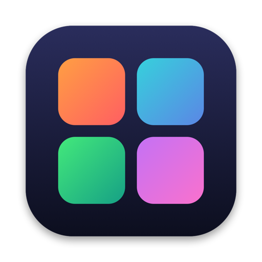

# zMac

**Một app menu bar thay cho bảy app trên macOS.**<br>
Nhẹ, miễn phí, mã nguồn mở.

[](https://zmac.vercel.app/#install)
[](https://zmac.vercel.app)


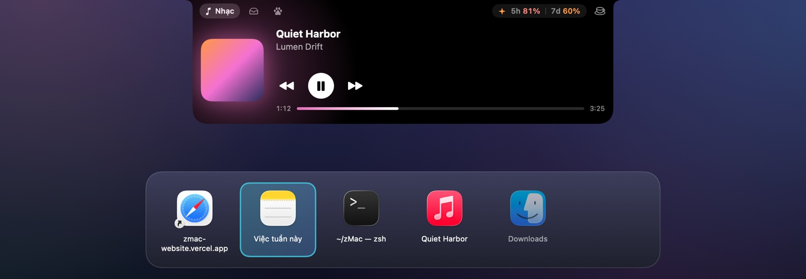

</div>

> **English:** zMac is a lightweight macOS menu bar app that replaces AltTab, Rectangle, Maccy, BetterDisplay, AlDente,
> FineTune and NotchNook with a single 24 MB process. Its notch also shows lyrics, your calendar, volume and brightness,
> and approves Claude Code permission requests. Free and open source (MIT), with a Vietnamese and English interface.

## Có gì bên trong

| | Tính năng | Thay cho | Làm gì |
|:-:|---|---|---|
| 🪟 | **Chuyển cửa sổ** | AltTab | `⌥⇥` duyệt từng cửa sổ (có ảnh xem trước), `` ⌥` `` cửa sổ của app hiện tại, tuỳ chọn thay `⌘⇥` |
| 📐 | **Chia cửa sổ** | Rectangle | `⌃⌥` + phím: nửa, góc, phần ba, phóng to, căn giữa, chuyển màn hình; kéo ra mép để xếp |
| 📋 | **Lịch sử clipboard** | Maccy | `⌘⇧C` mở lịch sử, tìm, ghim, dán; bỏ qua mật khẩu |
| 🖥️ | **Màn hình** | BetterDisplay | Độ sáng màn ngoài (DDC hoặc làm tối bằng phần mềm), độ phân giải, HiDPI |
| 🔋 | **Pin** | AlDente | Giới hạn sạc, sailing, chống nóng, xả về ngưỡng, sạc đầy một lần |
| 🔊 | **Âm thanh** | FineTune | Âm lượng và loa riêng từng app, đổi thiết bị vào ra |
| 🎵 | **Notch** | NotchNook | Nhạc đang phát với ảnh bìa (mọi trình phát, kể cả trình duyệt), lời bài hát, kệ file; âm lượng và độ sáng thay HUD macOS; báo pin khi cắm sạc, cảnh báo pin yếu |
| 📅 | **Lịch** | Itsycal | Tuần này ngay trong notch, chấm ngày có sự kiện, cuộc họp sắp tới kèm nút vào Meet / Zoom / Teams |
| ✳️ | **Claude Code** | | Claude xin quyền thì notch mở ra để Cho phép / Từ chối; Claude hỏi lại hay xin duyệt kế hoạch thì chọn ngay trên notch; hạn mức 5 giờ / 7 ngày |
| 🐾 | **Thú cưng** | | Mèo, cún, slime hay gà con pixel sống ở notch: cho ăn, vuốt ve, chơi để lên cấp |
| ☕ | **Giữ máy thức** | Amphetamine | Không cho máy ngủ trong khoảng thời gian bạn chọn |

Tính năng nào không dùng thì tắt: module tắt không được tạo ra nên không tốn RAM hay CPU.

## Notch

<p align="center">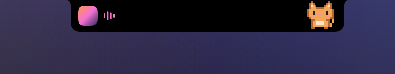</p>

Lúc thu gọn, notch hiện bài đang phát ở bên trái và thú cưng ở bên phải. Rê chuột (hoặc bấm) để mở: bên trái là
nhạc, kệ file hoặc thú cưng, bên phải là lịch tuần này.

<p align="center">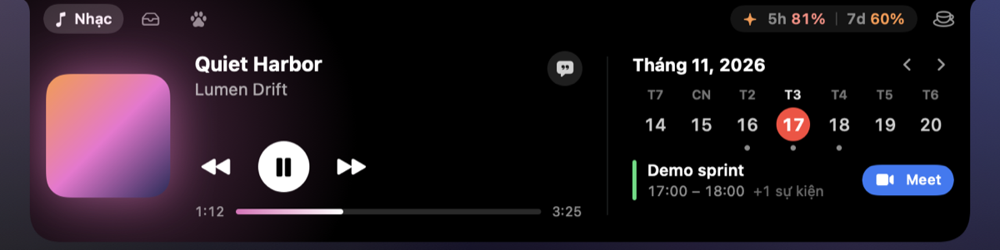</p>

<table>
<tr>
<td width="50%" valign="top">
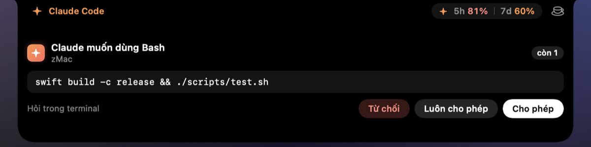<br>
<b>Duyệt quyền Claude Code.</b> Claude muốn chạy lệnh hay sửa file thì notch tự mở với đúng lệnh đó.
Trả lời trong terminal cũng được, thẻ tự biến mất. Bấm Kết nối trong Cài đặt là xong.
</td>
<td width="50%" valign="top">
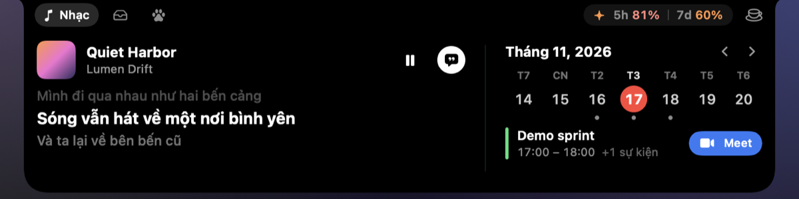<br>
<b>Lời bài hát.</b> Bấm nút Lời trong trình phát, lời thay chỗ ảnh bìa và chạy theo nhạc, dòng đang hát sáng lên.
Lấy từ <a href="https://lrclib.net">lrclib.net</a>, chỉ khi đang xem lời.
</td>
</tr>
<tr>
<td width="50%" valign="top">
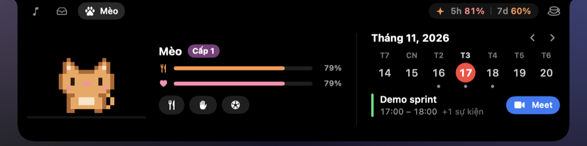<br>
<b>Thú cưng.</b> Bốn loài pixel do zMac tự vẽ. No và Vui giảm dần theo giờ thật; chơi với nó để lên cấp.
Hoạt hình chạy bằng Core Animation nên không tốn CPU.
</td>
<td width="50%" valign="top">
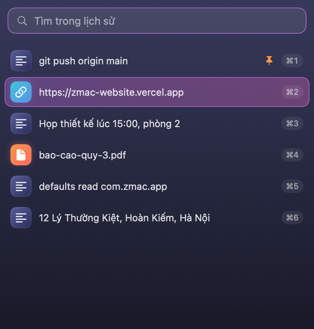<br>
<b>Lịch sử clipboard.</b> <code>⌘⇧C</code>, gõ để tìm, <code>⌘1</code> đến <code>⌘9</code> để dán ngay.
Ghim những gì hay dùng; mật khẩu từ trình quản lý mật khẩu không bao giờ được lưu.
</td>
</tr>
<tr>
<td width="50%" valign="top">
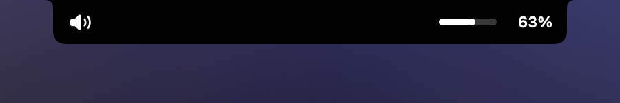<br>
<b>Âm lượng, độ sáng.</b> Phím âm lượng và độ sáng hiện mức trên hai cánh notch thay cho HUD của macOS.
Phím độ sáng chỉnh màn đang có con trỏ, kể cả màn ngoài và TV (làm tối bằng phần mềm).
</td>
<td width="50%" valign="top">
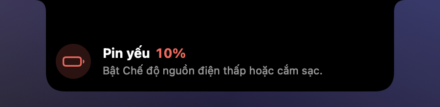<br>
<b>Pin yếu.</b> Còn 20%, 10% và 5% thì notch thả xuống một thẻ nhắc; cắm sạc là thẻ tự đóng.
Mốc đầu tiên chọn được trong Cài đặt.
</td>
</tr>
</table>

<p align="center">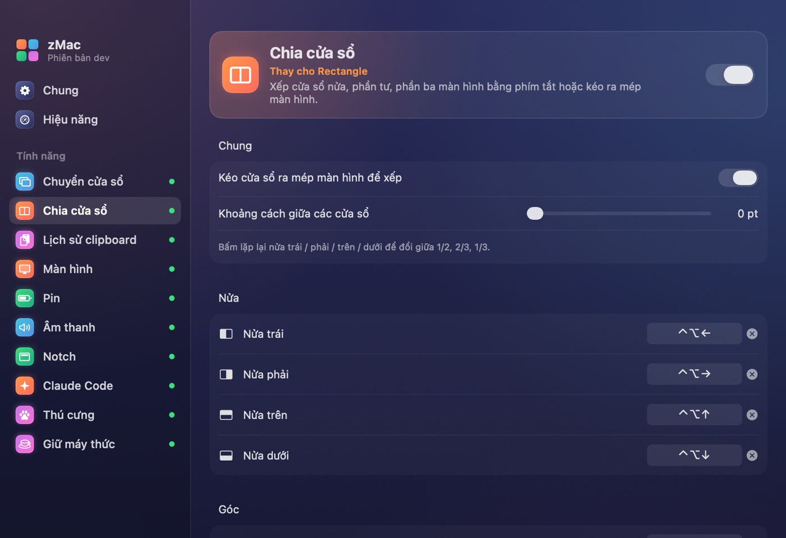</p>

## Nhẹ đến đâu

Đo trên MacBook Air M4, macOS 26.5, bật cả 11 tính năng:

| | zMac |
|---|---|
| Bộ nhớ (phys footprint) | **24 MB** |
| CPU khi rảnh, kể cả lúc notch đang chạy hoạt hình | **0%** |
| Kích thước app | 3 MB (app, daemon pin, hook Claude, adapter đọc nhạc) |
| Tiến trình đọc nhạc đang phát (chỉ khi bật Notch) | khoảng 6 MB, 0% CPU |
| Liệt kê cửa sổ cho `⌥⇥` | 4,4 ms cho 11 cửa sổ từ 9 app |

Để so sánh, cùng máy, cùng lúc: AltTab dùng 307 MB, Maccy 295 MB, NotchNook 50 MB. So như vậy chưa hoàn toàn ngang nhau:
AltTab giữ sẵn ảnh chụp cửa sổ, Maccy giữ lịch sử của bạn.

**Vì sao nhẹ** (chi tiết ở [docs/ARCHITECTURE.md](docs/ARCHITECTURE.md)):

- Một tiến trình thay cho bảy, dùng chung runtime Swift, AppKit, SwiftUI.
- Chạy theo sự kiện của hệ thống (IOKit, CoreAudio, NSWorkspace, EventKit, kqueue), không timer lặp.
  Phím tắt đăng ký với hệ thống nên phím bạn gõ không đi qua zMac. Ngoại lệ duy nhất là một event tap chỉ nhận
  phím âm lượng và độ sáng, để hiện chúng trên notch.
- Module tắt thì không tồn tại; module không hợp máy tự ẩn (Mac không pin thì không có khoá sạc).
- Hoạt hình trên notch giao cho Core Animation, WindowServer tự chạy, app không vẽ lại từng khung hình.
- Cửa sổ, bảng, popover huỷ view khi đóng. Build riêng cho chip của máy, strip ký hiệu.

## Cài đặt

Bằng Homebrew, một lệnh là xong và mở được ngay (không cần bước 2 bên dưới):

```sh
brew install --cask kienhungpg/tap/zmac
```

Cập nhật sau này bằng `brew upgrade --cask zmac`. Hoặc cài tay:

1. Tải `zMac.dmg` ở [trang web](https://zmac.vercel.app/#install), kéo zMac vào Applications.
2. zMac chưa được Apple công chứng (notarize), nên lần đầu mở macOS sẽ chặn. Vào **Cài đặt hệ thống → Quyền riêng tư &
   Bảo mật**, kéo xuống và bấm **Vẫn mở**. Chỉ cần làm một lần.
3. Cấp quyền **Trợ năng** khi zMac hỏi.

Cần macOS 14 trở lên. Bản DMG build cho Apple Silicon; máy Intel tự build bằng `ZMAC_UNIVERSAL=1 ./build.sh`.
Có gì mới ở từng bản: [CHANGELOG.md](CHANGELOG.md).

## Quyền riêng tư

**Mặc định zMac không kết nối mạng**, không tài khoản, không gửi số liệu. Hai tính năng dùng mạng đều tắt sẵn:

| Tính năng | Gọi tới | Khi nào |
|---|---|---|
| Lời bài hát (nút Lời trong notch) | `lrclib.net` | Khi đang xem lời. Chỉ gửi tên bài, ca sĩ, album, độ dài |
| Tự cập nhật (Cài đặt → Chung) | `api.github.com`, `github.com` | Lúc mở app và khi máy thức dậy, tối đa mỗi ngày một lần. Chỉ cài bản có chữ ký Ed25519 đúng |

Hạn mức Claude được đọc từ file Claude Code tự lưu trên máy (`~/.claude.json`), không gọi mạng, không đọc Keychain.
Lịch đọc từ app Lịch của macOS qua EventKit, chỉ đọc, không gửi đi đâu.

| Quyền | Dùng cho | Bắt buộc |
|---|---|---|
| Trợ năng | Chuyển và chia cửa sổ, dán từ clipboard, nút phát nhạc, phím âm lượng và độ sáng trên notch | Có, cho các tính năng đó |
| Lịch | Tuần này và cuộc họp sắp tới trong notch (chỉ đọc) | Chỉ khi bạn bấm Cho phép |
| Ghi âm thanh hệ thống | Âm lượng từng app (macOS hỏi lần đầu bạn chỉnh) | Chỉ khi dùng |
| Ghi màn hình | Ảnh xem trước trong `⌥⇥` | Không |
| Mật khẩu admin, một lần | Cài daemon giới hạn sạc | Chỉ khi dùng giới hạn sạc |

<details>
<summary><b>Dữ liệu lưu ở đâu</b></summary>

- Cài đặt: `defaults read com.zmac.app`
- Lịch sử clipboard: `~/Library/Application Support/zMac/Clipboard/` (`history.json` và ảnh PNG)
- Chính sách sạc: `/Library/Application Support/zMac/battery-policy.json` (daemon ghi)
- Claude Code: socket `~/Library/Application Support/zMac/claude.sock` khi tính năng bật. Bấm Kết nối thì zMac thêm
  một hook vào `~/.claude/settings.json` (bản cũ ở `settings.json.zmac-backup`), Gỡ kết nối bỏ đúng hook đó.
  Hạn mức gần nhất lưu trong defaults (`claude.usage`).

</details>

## Build từ mã nguồn

Chỉ cần Command Line Tools (`xcode-select --install`), không cần Xcode.

```bash
git clone https://github.com/KienHungPG/zMac.git && cd zMac
./scripts/make-signing-cert.sh   # một lần: chứng chỉ ký cố định để macOS giữ quyền qua các lần build
./build.sh install               # build, cài /Applications/zMac.app rồi mở
```

<details>
<summary><b>Các lệnh khác</b></summary>

```bash
./build.sh                        # build release, đóng gói build/zMac.app
./build.sh run                    # build rồi mở bản trong build/
./scripts/test.sh                 # chạy test (swift-testing)
.build/debug/zMac --diagnose      # in thông tin phần cứng, màn hình, pin, âm thanh, nhạc, hạn mức Claude
.build/debug/zMac --render-ui DIR # vẽ các màn hình ra PNG (thêm --vi hoặc --en để chọn ngôn ngữ)
```

Không có chứng chỉ thì `build.sh` ký ad-hoc: app vẫn chạy, nhưng sau mỗi lần build macOS coi là app mới và bắt cấp lại quyền.
Kiến trúc, quy tắc tối ưu và API riêng của macOS mà zMac dùng: [docs/ARCHITECTURE.md](docs/ARCHITECTURE.md).

</details>

<details>
<summary><b>Khoá sạc: cài và gỡ</b></summary>

Cài trong Cài đặt → Pin → "Cài". Daemon `com.zmac.helper` nằm ở `/Library/PrivilegedHelperTools`, launchd giữ nó chạy.
Trên M4 nó dùng key SMC `CHTE` (chặn sạc) và `CHIE` (ngắt adapter để xả); M1 đời đầu dùng `CH0B`/`CH0C`.
Bấm "Gỡ" là daemon trả SMC về mặc định rồi tự xoá. Nếu cần gỡ tay:

```bash
sudo launchctl bootout system/com.zmac.helper
sudo /Library/PrivilegedHelperTools/com.zmac.helper restore
sudo rm -f /Library/PrivilegedHelperTools/com.zmac.helper /Library/LaunchDaemons/com.zmac.helper.plist
```

</details>

<details>
<summary><b>Phát hành bản cập nhật (cho người duy trì)</b></summary>

1. Một lần: `swift scripts/update-sign.swift genkey` tạo khoá bí mật ở `~/.zmac/update-key` (sao lưu nó, không commit)
   và ghi khoá công khai vào `Resources/update-public-key.txt` (commit file này; `build.sh` gắn nó vào app).
2. Tăng `CFBundleShortVersionString` / `CFBundleVersion` trong `Resources/Info.plist`, thêm mục mới vào `CHANGELOG.md`
   và `website/changelog.json` (trang web đọc file này cho mục Phiên bản).
3. `./scripts/make-release.sh`: build, DMG cho trang web, cask Homebrew `packaging/homebrew/zmac.rb`,
   `build/release/zMac-X.Y.Z.zip` và chữ ký `.zip.sig` (khi đã có khoá), ghi chú lấy từ CHANGELOG, rồi in lệnh
   `gh release create` để bạn tự chạy.
4. Chép `packaging/homebrew/zmac.rb` sang repo [KienHungPG/homebrew-tap](https://github.com/KienHungPG/homebrew-tap)
   (`Casks/zmac.rb`) và push. Cask tải `zMac.dmg` từ GitHub Release `vX.Y.Z`, nên release phải có đúng file DMG đó.

App chỉ nhận bản cập nhật ký bằng đúng khoá đó. Mất khoá bí mật thì bản đã cài không tự cập nhật được nữa
(người dùng phải tải lại bản mới từ trang web).

</details>

## Hạn chế đã biết

- Nhạc đang phát: từ macOS 15.4 app bên thứ ba không gọi thẳng MediaRemote được, nên Notch đọc qua
  [mediaremote-adapter](https://github.com/ungive/mediaremote-adapter). Nếu bản macOS sau chặn cả cách này, Notch lùi về
  Music và Spotify, không có ảnh bìa.
- `⌥⇥` chỉ thấy cửa sổ ở Space hiện tại, cộng cửa sổ thu nhỏ và app đang ẩn.
- Chưa có: màn hình ảo / mở khoá HiDPI cho màn 1440p (như BetterDisplay), âm lượng tổng cho loa HDMI, EQ từng app.

## Góp ý và báo lỗi

Gặp lỗi hay muốn thêm tính năng: mở một [issue](https://github.com/KienHungPG/zMac/issues). Khi báo lỗi, dán kèm kết quả
của `zMac --diagnose` (chạy `/Applications/zMac.app/Contents/MacOS/zMac --diagnose` trong Terminal) sẽ giúp tìm ra nhanh hơn.
Pull request luôn được chào đón; đọc [CLAUDE.md](CLAUDE.md) và [docs/ARCHITECTURE.md](docs/ARCHITECTURE.md) trước khi sửa.

## Cảm ơn

- [mediaremote-adapter](https://github.com/ungive/mediaremote-adapter) (BSD 3-Clause): đọc nhạc đang phát, nhúng nguyên mã ở `Vendor/MediaRemoteAdapter`.
- [lrclib.net](https://lrclib.net): kho lời bài hát miễn phí.
- [HyperMac](https://github.com/mrgoose000000-gif/HyperMac) (GPL-3.0): tham khảo cách dùng các key SMC, không chép code.
- [yabai](https://github.com/koekeishiya/yabai) (MIT): cách đưa đúng một cửa sổ lên trước bằng SkyLight.
- [MonitorControl](https://github.com/MonitorControl/MonitorControl) (MIT): định dạng gói DDC/CI trên Apple Silicon.

## Giấy phép

[MIT](LICENSE) © KienHungPG. Miễn phí: ai cũng được dùng, sửa và phân phối lại, chỉ cần giữ dòng bản quyền.
